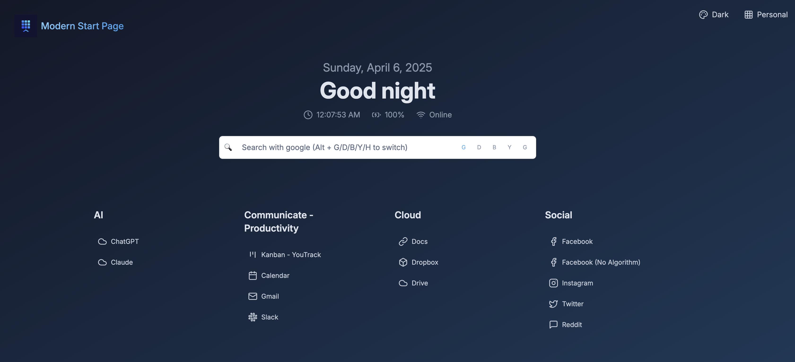

# Modern Start Page

A modern, customizable browser start page built with Astro and React. Features a clean UI, multiple search engines, theme switching, and persistent configuration. Perfect for self-hosted server dashboards and new tab pages.



> **Note:** This project was heavily influenced by [SUI](https://github.com/jeroenpardon/sui), a start page that served as my daily driver for many years. After 5-6 years since its last update, I decided to modernize the concept with current web technologies while maintaining its core functionality and simplicity.

## Features

- 🎨 Multiple pre-defined themes with easy customization
- 🔍 Support for multiple search engines
- 📱 Responsive design that works on all devices
- 📦 Simple JSON-based configuration
- 🐳 Easy Docker deployment
- 🔄 Persistent configuration with file-based storage
- 🎯 Clean, modern UI with Lucide icons
- ⚡ Fast and lightweight
- 🌤️ Widget support (Weather, Clock, and more to come)

## Getting Started

### Prerequisites

- Node.js (v18 or higher)
- npm or yarn
- OpenWeather API key (for weather widget)

### Installation

1. Clone the repository:
```bash
git clone https://github.com/ericblue/modern-start-page.git
cd modern-start-page
```

2. Install dependencies:
```bash
npm install
```

3. Create a `.env` file based on `.env.example` and add your OpenWeather API key:
```bash
cp .env.example .env
# Edit .env and add your OpenWeather API key
```

4. Start the development server:
```bash
npm run dev
```

5. Build for production:
```bash
npm run build
```

## Configuration

The application uses a simple JSON file storage system for configuration. Here's the default configuration structure:

```json
{
  "contexts": [
    {
      "id": "default",
      "name": "Default",
      "categories": [
        {
          "name": "Development",
          "displayMode": "icon",
          "links": [
            {
              "name": "GitHub",
              "url": "https://github.com",
              "icon": "github"
            },
            {
              "name": "GitLab",
              "url": "https://gitlab.com",
              "icon": "gitlab"
            }
          ]
        },
        {
          "name": "Social",
          "displayMode": "icon",
          "links": [
            {
              "name": "Twitter",
              "url": "https://twitter.com",
              "icon": "twitter"
            },
            {
              "name": "Reddit",
              "url": "https://reddit.com",
              "icon": "reddit"
            }
          ]
        }
      ]
    }
  ],
  "activeContext": "default",
  "theme": "dark",
  "gridColumns": 4,
  "displayMode": "icon",
  "showCategoryBorders": true,
  "widgets": {
    "weather": {
      "enabled": true,
      "useCelsius": false
    },
    "clock": {
      "enabled": true,
      "showSeconds": true
    }
  }
}
```

### Widgets

The start page includes several widgets that can be enabled/disabled and customized:

- **Weather Widget**: Shows current weather conditions based on your location
  - Requires an OpenWeather API key
  - Can toggle between Celsius and Fahrenheit
  - Automatically detects your location

- **Clock Widget**: Displays the current time
  - Can show/hide seconds
  - Updates in real-time

Widget settings can be configured through the settings modal, where you can:
- Enable/disable individual widgets
- Configure widget-specific settings
- Customize the appearance and behavior

### Customization Options

- Theme selection (Dark/Light)
- Layout customization (grid columns, display mode)
- Quick links management with icons
- Search engine preferences
- Multiple contexts for different use cases
- Category-based organization

## Docker Support

The application can be run in a Docker container:

```bash
# Build the image
docker build -t modern-start-page:latest .

# Run the container
docker run -p 4000:4000 modern-start-page:latest
```

## Setting as Default Home Page

### Google Chrome
1. Click the three-dot menu (⋮) in the top-right corner
2. Go to Settings
3. Under "On startup", select "Open a specific page or set of pages"
4. Click "Add a new page"
5. Enter your Modern Start Page URL (e.g., `http://localhost:4000` or your deployed URL)
6. Click "Add"

### Mozilla Firefox
1. Click the three-line menu (☰) in the top-right corner
2. Go to Settings
3. Under "Home" section, find "Homepage and new windows"
4. Select "Custom URLs..."
5. Enter your Modern Start Page URL (e.g., `http://localhost:4000` or your deployed URL)
6. Click "Save"

### Safari
1. Click Safari in the menu bar
2. Go to Settings (or Preferences)
3. Select the "General" tab
4. In the "Homepage" field, enter your Modern Start Page URL (e.g., `http://localhost:4000` or your deployed URL)
5. Close the settings window

> **Note:** If you're running Modern Start Page locally, make sure to use the correct port number (default is 4000). For production deployments, use your deployed URL.

## Version History

| Version | Date | Description |
|---------|------|-------------|
| [v0.1.0](https://github.com/ericblue/modern-start-page/releases/tag/v0.1.0) | 2025-04-06 | Initial release - Astro/React start page with themes, search engines, widgets, Docker support |
| v0.2.0 | 2026-04-04 | Security hardening - Alpine base image, Node 22 LTS, pruned build-only deps, standalone server |

## Contributing

Contributions are welcome! Please feel free to submit a Pull Request.

## License

This project is licensed under the MIT License - see the [LICENSE](LICENSE) file for details.

## Author

Created by Eric Blue (https://ericblue.com)
